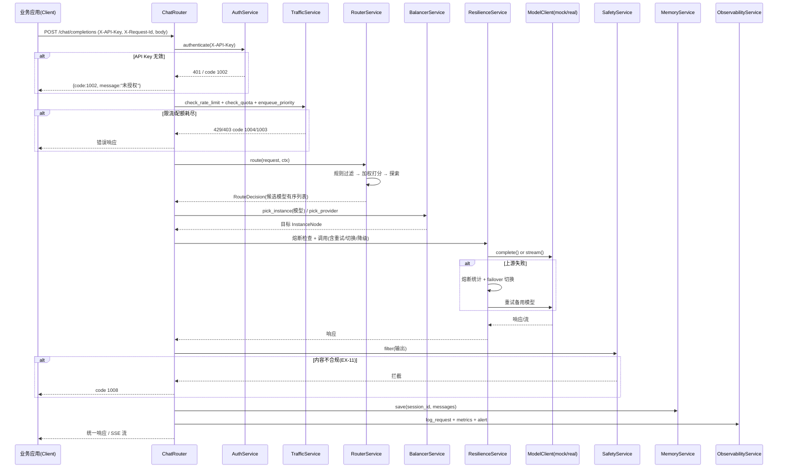

# 模型网关（Model Gateway）系统架构设计

> 版本 v1.0 · 作者：架构师高见远（Gao） · 状态：工程师（寇豆码）编码唯一依据
> 技术栈（已确定，不可更改）：后端 **FastAPI + SQLite**，前端 **React 18 + TypeScript + Vite + Tailwind CSS**

---

## 1. 产品定位

模型网关是「业务应用」与「后端大模型供应商」之间的**统一接入与调度层**。业务方持 API Key 调用网关统一入口，网关负责：智能路由、负载均衡、容灾切换、持久记忆、流量控制、鉴权、日志监控、内容安全过滤。

---

## 2. 实现方案与框架选型理由

### 2.1 核心难点分析

| 难点 | 说明 | 应对 |
|------|------|------|
| 两段式路由 | 硬性规则过滤 + 加权打分（成本/延迟/质量），权重按场景标签可配，需含探索机制 | 纯内存计算，无外部依赖；策略与规则入 SQLite，可热读 |
| 容灾状态机 | 熔断（滑动窗口错误率 + 半开试探）、故障切换、降级、重试退避、幂等防重复计费 | 每个模型/实例维护内存态状态机 + 定时健康探测；滑动窗口用内存环形队列 |
| 可插拔上游 | 真实供应商调用与本地 mock 端点共存，demo 不依赖真实 API Key | `ModelClient` 抽象接口 + `MockModelClient`/`OpenAIClient` 实现，按 `provider.provider_type` 工厂实例化 |
| 持久记忆分层 | 热/冷数据、TTL、用户删除、最终一致 | demo 用「内存 dict（热）+ SQLite（冷）」模拟；接口保持分层抽象 |
| 低延迟 NFR | 网关转发 P95 ≤ 50ms | 全异步（async/await）、路由/LB/限流全部内存计算、mock 端点本地进程内返回 |
| 流式 SSE | 流式响应中断处理（EX-09） | FastAPI `StreamingResponse` + SSE 事件协议；中断时补记状态 |

### 2.2 框架选型

**后端**
- `fastapi` + `uvicorn[standard]`：异步高性能、自动 OpenAPI、原生 SSE `StreamingResponse` 支持。
- `sqlalchemy>=2.0`：ORM 建模 19 张表，`sessionmaker` + SQLite；比裸 `sqlite3` 更易维护与扩展。
- `pydantic` + `pydantic-settings`：请求/响应 schema 校验、配置管理（`.env`）。
- `httpx`：真实供应商调用的异步 HTTP 客户端（可插拔）；mock 端点不依赖它但仍保留依赖以备真实接入。
- 不引入 Redis/Celery：demo 用进程内内存做热数据与滑动窗口，降低部署复杂度（接口已抽象，可后续替换）。

**前端**
- `react@18` + `react-dom@18` + `typescript` + `vite` + `@vitejs/plugin-react`。
- `tailwindcss` + `postcss` + `autoprefixer`：按原型还原深色控制台视觉（OKLCH 色彩、琥珀强调色）。
- `react-router-dom`：9 个页面路由。
- `axios`：统一请求封装 + 拦截器（统一响应 envelope 解析、错误提示）。
- 图表**不用第三方库**：按原型风格用内联 SVG 手绘折线/条形图（无额外依赖，视觉完全可控）。

### 2.3 架构模式

- 后端：**分层架构（Router → Service → Model）+ 依赖注入（FastAPI Depends）**。路由层只做参数校验与响应封装；服务层承载调度/韧性/流量/记忆/安全逻辑；模型层为 SQLAlchemy ORM。
- 前端：**组件化 + 页面路由 + hooks 轮询**。共享 UI 组件抽离，页面通过 `usePolling` 定时刷新（监控类页面默认 3s 轮询）。

---

## 3. 系统分层

```
┌─────────────────────────────────────────────────────────────────┐
│ 接入层      API Key 鉴权中间件（X-API-Key → Tenant）              │
├─────────────────────────────────────────────────────────────────┤
│ 治理层      流量控制 TrafficService：限流(令牌桶/滑动窗口)        │
│             + 配额(租户周期配额) + 优先级(P0-P3 抢占)             │
├─────────────────────────────────────────────────────────────────┤
│ 调度层      RouterService(两段式路由) + BalancerService(实例/供应商)│
├─────────────────────────────────────────────────────────────────┤
│ 韧性层      ResilienceService：健康检查 + 熔断 + 故障切换         │
│             + 降级 + 重试(退避) + 幂等去重                        │
├─────────────────────────────────────────────────────────────────┤
│ 执行层      ModelClient(抽象) → MockModelClient / OpenAIClient    │
│             + SafetyService(内容过滤, EX-11)                      │
├─────────────────────────────────────────────────────────────────┤
│ 记忆层      MemoryService：会话上下文(热) + 历史状态(冷) + TTL    │
├─────────────────────────────────────────────────────────────────┤
│ 数据层      SQLite(19 表) + 内存快照(限流桶/滑动窗口/熔断状态)     │
├─────────────────────────────────────────────────────────────────┤
│ 观测层      ObservabilityService：RequestLog + 指标 + Alert        │
└─────────────────────────────────────────────────────────────────┘
```

---

## 4. 目录结构（文件清单）

```
model-gateway/
├── docs/
│   ├── ARCHITECTURE.md          # 本文档
│   ├── API_CONTRACT.md          # REST API 契约
│   ├── DATA_MODEL.md            # 数据模型 + SQLite 表 + 种子数据
│   ├── TASK_BREAKDOWN.md        # 任务分解（实现顺序）
│   ├── class-diagram.mermaid    # 类图
│   └── sequence-diagram.mermaid # 时序图
├── backend/
│   ├── requirements.txt
│   ├── .env.example
│   └── app/
│       ├── __init__.py
│       ├── main.py              # FastAPI 入口：CORS、中间件、路由注册、启动建表+seed
│       ├── config.py            # pydantic-settings 配置
│       ├── db.py                # SQLAlchemy engine / SessionLocal / Base / get_db
│       ├── models.py            # 19 张 ORM 表
│       ├── schemas.py           # Pydantic 请求/响应模型
│       ├── seed.py              # 种子数据（demo 启动即有数据）
│       ├── deps.py              # 依赖注入：get_db / get_current_tenant(API Key 鉴权)
│       ├── routers/
│       │   ├── __init__.py
│       │   ├── chat.py          # POST /api/v1/chat/completions（网关转发核心入口）
│       │   ├── overview.py      # 监控大盘
│       │   ├── routing.py       # 智能路由
│       │   ├── providers.py     # 供应商 + 模型实例
│       │   ├── balancing.py     # 负载均衡
│       │   ├── traffic.py       # 流量控制
│       │   ├── memory.py        # 持久记忆
│       │   ├── resilience.py    # 容灾策略
│       │   ├── alerts.py        # 告警中心
│       │   └── settings.py      # 系统设置
│       ├── services/
│       │   ├── __init__.py
│       │   ├── auth_service.py      # API Key 鉴权 + 密钥托管
│       │   ├── traffic_service.py   # 限流/配额/优先级
│       │   ├── router_service.py    # 两段式智能路由 + 探索
│       │   ├── balancer_service.py  # 实例级/供应商级 LB + 一致性哈希
│       │   ├── resilience_service.py# 健康检查/熔断/切换/降级/重试
│       │   ├── memory_service.py    # 会话上下文 + 热冷分层 + TTL + 删除
│       │   ├── model_client.py      # ModelClient 抽象 + 工厂
│       │   ├── mock_backend.py      # 本地 mock 模型端点（可跑 demo）
│       │   ├── safety_service.py    # 内容安全过滤（EX-11）
│       │   └── observability.py     # 请求日志 + 指标聚合 + 告警生成
│       └── utils/
│           ├── __init__.py
│           ├── idempotency.py       # 幂等去重（EX-07）
│           └── sliding_window.py    # 滑动窗口 + 令牌桶
├── frontend/
│   ├── package.json
│   ├── vite.config.ts
│   ├── tsconfig.json
│   ├── tsconfig.node.json
│   ├── tailwind.config.js
│   ├── postcss.config.js
│   ├── index.html
│   └── src/
│       ├── main.tsx
│       ├── App.tsx                 # 路由 + 布局
│       ├── index.css               # Tailwind 指令 + 设计 token
│       ├── types/index.ts          # 前端 TS 类型（与后端 schema 对齐）
│       ├── api/
│       │   ├── client.ts           # axios 实例 + 拦截器
│       │   └── index.ts            # 各模块 API 函数
│       ├── components/
│       │   ├── Layout.tsx          # 侧边栏 + 顶栏 + 内容区
│       │   ├── Sidebar.tsx
│       │   ├── MetricCard.tsx
│       │   ├── Panel.tsx
│       │   ├── Badge.tsx
│       │   ├── ProgressBar.tsx
│       │   ├── Switch.tsx
│       │   ├── LineChart.tsx       # 内联 SVG 折线图
│       │   └── TestRequestModal.tsx # 「新建请求」测试弹窗（调用 chat 接口）
│       ├── hooks/usePolling.ts
│       └── pages/
│           ├── Overview.tsx
│           ├── Routing.tsx
│           ├── Providers.tsx
│           ├── Balancing.tsx
│           ├── Traffic.tsx
│           ├── Memory.tsx
│           ├── Resilience.tsx
│           ├── Alerts.tsx
│           └── Settings.tsx
└── README.md                      # 启动说明
```

---

## 5. 类图（核心实体与服务）

```mermaid
classDiagram
    class Tenant {
        +int id
        +str name
        +str api_key_prefix
        +int quota_daily
        +int quota_used_daily
        +int quota_monthly
        +int quota_used_monthly
        +int token_quota_monthly
        +int token_used_monthly
        +str priority_default
        +str status
    }
    class ApiKey {
        +int id
        +int tenant_id
        +str key_hash
        +str key_prefix
        +str name
        +str status
        +str expires_at
    }
    class Provider {
        +int id
        +str name
        +str provider_type
        +str base_url
        +str api_key_encrypted
        +str api_key_masked
        +str status
        +int quota_total
        +int quota_used
        +float success_rate
        +float cost_weight
    }
    class ModelInstance {
        +int id
        +int provider_id
        +str name
        +str capabilities_json
        +float input_price
        +float output_price
        +str currency
        +int max_context_tokens
        +str tier
        +str status
        +float latency_p50
        +float latency_p95
        +int load
        +float quality_score
    }
    class InstanceNode {
        +int id
        +int model_instance_id
        +str name
        +int weight
        +int current_connections
        +str status
    }
    class RoutePolicy {
        +int id
        +str name
        +str scenario_tag
        +float weight_cost
        +float weight_latency
        +float weight_quality
        +float exploration_rate
        +bool is_default
        +str status
    }
    class RouteRule {
        +int id
        +str name
        +str rule_type
        +str condition_json
        +str action
        +int priority
        +bool enabled
    }
    class BalancingGroup {
        +int id
        +str name
        +str strategy
        +str provider_strategy
        +str config_json
    }
    class ResiliencePolicy {
        +int id
        +str scope_type
        +int scope_id
        +float failure_rate_threshold
        +int cooldown_seconds
        +bool half_open_enabled
        +str failover_mode
        +str backup_selection
        +str degrade_mode
        +str backup_chain_json
        +int retry_count
        +str status
        +int switch_count
    }
    class Session {
        +int id
        +str session_id
        +int tenant_id
        +int message_count
        +int context_tokens
        +str status
        +str last_active_at
        +int ttl_seconds
    }
    class Memory {
        +int id
        +int session_id
        +str role
        +str content
        +int tokens
        +str storage_tier
        +str expires_at
    }
    class RateLimitRule {
        +int id
        +str name
        +str dimension
        +int threshold
        +int window_seconds
        +str algorithm
        +str action
        +bool enabled
    }
    class PriorityQueue {
        +int id
        +str priority
        +str scenario
        +int queue_length
        +int wait_ms
    }
    class RequestLog {
        +int id
        +str request_id
        +int tenant_id
        +str session_id
        +int provider_id
        +int model_instance_id
        +int route_policy_id
        +str priority
        +int prompt_tokens
        +int completion_tokens
        +int latency_ms
        +float cost
        +str status
        +str error_code
        +bool is_stream
    }
    class Alert {
        +int id
        +str severity
        +str title
        +str description
        +str source
        +str status
        +str resolved_at
    }
    class AuthService {
        +authenticate(api_key) Tenant
        +issue_api_key(tenant_id) ApiKey
        +mask_key(key) str
    }
    class TrafficService {
        +check_rate_limit(tenant, model, dims) bool
        +check_quota(tenant) bool
        +enqueue_priority(priority) void
    }
    class RouterService {
        +route(req, ctx) RouteDecision
        +filter(candidates, rules) list
        +score(candidates, policy) list
        +explore(candidates) ModelInstance
    }
    class BalancerService {
        +pick_instance(model) InstanceNode
        +pick_provider(candidates) Provider
        +consistent_hash(key, ring) InstanceNode
    }
    class ResilienceService {
        +check_health() void
        +should_open(model) bool
        +failover(model) ModelInstance
        +degrade() ModelInstance
        +retry(callable, ctx) response
    }
    class ModelClient {
        <<abstract>>
        +complete(payload) Awaitable
        +stream(payload) AsyncIterator
    }
    class MockModelClient {
        +complete(payload) Awaitable
        +stream(payload) AsyncIterator
    }
    class MemoryService {
        +get_context(session_id) list
        +save(session_id, messages) void
        +delete(session_id) void
        +expire_ttl() void
    }
    class SafetyService {
        +filter(content) SafetyResult
    }
    class ObservabilityService {
        +log_request(ctx) void
        +aggregate_metrics() dict
        +raise_alert(severity, title, desc, source) void
    }

    Tenant "1" --> "*" ApiKey
    Tenant "1" --> "*" Session
    Provider "1" --> "*" ModelInstance
    ModelInstance "1" --> "*" InstanceNode
    RoutePolicy "1" --> "*" RouteRule
    Session "1" --> "*" Memory
    Provider "1" --> "*" ResiliencePolicy
    ModelInstance "1" --> "*" RequestLog
    ModelClient <|-- MockModelClient
    RouterService ..> ModelInstance
    BalancerService ..> InstanceNode
    ResilienceService ..> ModelClient
    ObservabilityService ..> RequestLog
    ObservabilityService ..> Alert
```



> 完整类图另存于 `docs/class-diagram.mermaid`；完整字段与 SQLite DDL 见 `docs/DATA_MODEL.md`。

---

## 6. 核心调用流程

### 6.1 网关转发主链路（POST /api/v1/chat/completions）



### 6.2 健康检查与熔断状态机（后台周期任务）

```
启动时 + 每 5s：ResilienceService.check_health()
  主动探测：MockModelClient.ping()（真实供应商则 GET /health）
  被动采集：从 RequestLog 滑动窗口统计错误率
  状态迁移：healthy → open（错误率超阈值）→ half_open（冷却到期放行试探）→ healthy/closed
  每次迁移 → ObservabilityService.raise_alert()
```

> 完整时序图另存于 `docs/sequence-diagram.mermaid`。

---

## 7. 关键设计决策

| 决策点 | 决策 | 理由 |
|--------|------|------|
| 统一响应格式 | 所有接口返回 `{code, message, data}`，code=0 成功 | 前端拦截器统一处理 |
| 时间格式 | 存储与传输统一 **ISO 8601 UTC** 字符串（`2026-10-02T14:32:08Z`），前端本地化展示 | 避免时区歧义 |
| 金额精度 | 定价存「每 1M tokens 单价」float；成本统一折算 **USD，4 位小数**；汇率常量 7.2 存 gateway_settings | 跨币种可聚合 |
| 鉴权 | 业务调用 `X-API-Key` 头（`gw_` 前缀 + 32 hex）；控制台管理 API demo 阶段不鉴权（README 注明） | 网关统一入口 |
| 可插拔上游 | `ModelClient` 抽象 + 工厂按 `provider_type`（`mock`/`openai`/`anthropic`/`zhipu`）实例化；`mock` 走本地进程内生成 | demo 不依赖真实 Key |
| 策略下发延迟(EX-10) | 路由策略/限流规则读取走内存快照（启动加载 + 写操作即时失效重建），不做跨进程推送 | 本地快照消除下发延迟 |
| 探索机制 | 路由打分阶段以 `exploration_rate`（默认 0.05）概率从候选随机挑一个非最优模型 | 避免冷启动局部最优 |
| 热冷分层 | 热数据=进程内 dict（会话上下文）；冷数据=SQLite `memories`；最终一致=写入先热后异步落冷 | demo 简化，接口抽象可替换 Redis/向量库 |

---

## 8. 异常场景（11 项）处理位置映射

| 编号 | 场景 | 处理逻辑 | 代码位置 |
|------|------|----------|----------|
| EX-01 | 供应商宕机 | 健康检查失败 → 熔断摘流 → 自动切换备用链路 | resilience_service.py |
| EX-02 | 供应商限流 429 | 捕获 429 → 指数退避重试 → 仍失败切换 | resilience_service.py / model_client.py |
| EX-03 | 请求超时 | 分级超时（默认 30s / 首 token 5s）→ 重试 → 降级 | config.py / resilience_service.py |
| EX-04 | 全部高优不可用 | 按 degrade_mode 降级到低档/兜底话术 | resilience_service.py |
| EX-05 | 租户配额耗尽 | 明确错误码 1003（HTTP 403） | traffic_service.py |
| EX-06 | 瞬时流量突刺 | 令牌桶/滑动窗口限流削峰 → 429 | traffic_service.py / utils/sliding_window.py |
| EX-07 | 重复请求 | `X-Request-Id` 幂等去重，返回缓存响应，防重复计费 | utils/idempotency.py |
| EX-08 | 上下文过长/记忆写回失败 | 超长截断 + 写回失败告警降级不阻断主链路 | memory_service.py |
| EX-09 | 流式响应中断 | SSE 生成器 try/finally 补记请求状态 + 告警 | routers/chat.py |
| EX-10 | 策略下发延迟 | 本地内存快照即时生效 | router_service.py / traffic_service.py |
| EX-11 | 输出内容不合规 | SafetyService 关键词/规则过滤 → code 1008 | safety_service.py |

---

## 9. 共享约定（工程师必须遵守）

1. **统一响应包**：`{"code": 0, "message": "ok", "data": <payload>}`；列表接口 `data` 为 `{items: [], total: n}` 或数组（以契约为准）。
2. **错误码**：见 `API_CONTRACT.md` 第 3 节错误码表；业务错误同时返回合适 HTTP 状态码。
3. **时间**：一律 ISO 8601 UTC 字符串，秒级（`YYYY-MM-DDTHH:mm:ssZ`）。
4. **金额/成本**：`cost` 统一 USD、4 位小数；定价单价按原生币种（`currency` 字段 `USD`/`CNY`）。
5. **ID 规范**：`session_id` 用 `sess_<8hex>`；`request_id` 用 `req_<uuid8>`；API Key 用 `gw_<32hex>`；模型名/实例名全小写中划线。
6. **鉴权**：业务转发接口必须校验 `X-API-Key`；控制台接口 demo 阶段开放。
7. **数据库**：SQLite 文件路径 `backend/data/gateway.db`（gitignore）；启动时自动建表 + 幂等 seed（已存在数据则跳过）。
8. **前端轮询**：监控类页面 3s 轮询；配置类页面加载一次 + 手动刷新。
9. **SSE 协议**：`Content-Type: text/event-stream`，事件 `start` / `delta` / `done` / `error`，以 `data: [DONE]` 结束。
