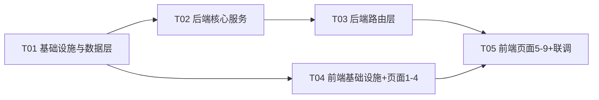

# 模型网关任务分解（实现顺序）

> 版本 v1.0 · 执行者：工程师寇豆码 · 依据：ARCHITECTURE.md / API_CONTRACT.md / DATA_MODEL.md
> 原则：**5 个任务**，按依赖排序；每个任务包含一组强相关文件；任务间尽量并行（仅依赖 T01）。

---

## 0. 依赖关系总览



- 硬依赖：T01 → T02 → T03；T01 → T04 → T05。
- T04 可与 T02/T03 **并行**开发（前端只依赖 API 契约文档 + T01 的类型定义）。
- T05 软依赖 T03（联调需后端接口就绪）。

---

## 1. T01 项目基础设施与数据层

**目标**：搭起可启动的空壳 + 完整数据层。后端能 `uvicorn` 起服务并建表+seed；前端能 `npm run dev` 打开空布局。

**优先级**：P0

**源文件**：
```
backend/requirements.txt
backend/.env.example
backend/app/__init__.py
backend/app/config.py          # pydantic-settings：DB 路径、默认超时、CORS
backend/app/db.py              # engine / SessionLocal / Base / get_db
backend/app/models.py          # 19 张 ORM 表（严格对齐 DATA_MODEL.md）
backend/app/schemas.py         # Pydantic 请求/响应模型 + 统一 envelope
backend/app/seed.py            # 幂等种子数据（对齐 DATA_MODEL.md 第 3 节）
backend/app/deps.py            # get_db / get_current_tenant（API Key 鉴权依赖）
backend/app/main.py            # FastAPI 入口：建表+seed 生命周期、CORS、路由注册占位
backend/app/utils/__init__.py
backend/app/utils/sliding_window.py  # TokenBucket + SlidingWindow 数据结构
backend/app/utils/idempotency.py     # 幂等缓存 + 落库
frontend/package.json
frontend/vite.config.ts        # 端口 5173 + /api 代理到 8000
frontend/tsconfig.json
frontend/tsconfig.node.json
frontend/tailwind.config.js
frontend/postcss.config.js
frontend/index.html
frontend/src/main.tsx
frontend/src/App.tsx           # react-router 9 页路由骨架（页面先占位）
frontend/src/index.css         # Tailwind 指令 + 设计 token（深色/琥珀，对齐原型）
frontend/src/types/index.ts    # 前端 TS 类型（对齐 schemas.py / API 契约）
README.md                      # 启动说明（含种子 API Key 列表）
```

**依赖**：无

**验收标准**：
1. `cd backend && uvicorn app.main:app --reload` 启动成功，`GET /api/v1/health` 返回 `{code:0,data:{status:"up"}}`。
2. 首次启动自动生成 `backend/data/gateway.db`，19 张表齐全、种子数据写入（可 `sqlite3` 查询验证）。
3. `cd frontend && npm install && npm run dev` 启动，`/` 打开侧边栏（9 菜单）+ 顶栏骨架。
4. 类型定义 `types/index.ts` 与后端 `schemas.py` 字段名一一对应。

---

## 2. T02 后端核心服务（调度引擎）

**目标**：实现全部业务服务层——这是网关的「大脑」，承载路由/均衡/韧性/流量/记忆/安全/观测 + 可插拔模型客户端。本任务不含 HTTP 路由，只交付可单测的 Service 类。

**优先级**：P0

**源文件**：
```
backend/app/services/__init__.py
backend/app/services/auth_service.py      # API Key 校验/签发/掩码/密钥托管
backend/app/services/traffic_service.py   # 限流(令牌桶/滑动窗口)+配额+优先级抢占
backend/app/services/router_service.py    # 规则过滤→加权打分→探索(EX-10 本地快照)
backend/app/services/balancer_service.py  # 实例级加权最小连接/轮询 + 供应商分流 + 一致性哈希
backend/app/services/resilience_service.py# 健康检查+熔断(滑动窗口/半开)+切换+降级+退避重试
backend/app/services/model_client.py      # ModelClient 抽象 + 工厂(按 provider_type)
backend/app/services/mock_backend.py      # 本地 mock 模型端点(可跑 demo，不依赖真实 Key)
backend/app/services/memory_service.py    # 会话上下文(热内存+冷 SQLite)+TTL+删除(EX-08)
backend/app/services/safety_service.py    # 内容安全过滤(EX-11)
backend/app/services/observability.py     # RequestLog 写入 + 指标聚合 + Alert 生成
```

**依赖**：T01

**验收标准**：
1. `RouterService.route()` 能对给定请求返回 `RouteDecision`（候选有序列表 + 选中模型），覆盖 3 个场景标签权重差异。
2. `BalancerService.pick_instance()` 加权最小连接/轮询/一致性哈希三策略可跑通；`pick_provider()` 按配额+成功率+成本分流。
3. `ResilienceService` 熔断状态机可演示：mock 连续失败 → open → 冷却 → half_open 试探 → healthy；失败可 failover 到备用链路、全部不可用可 degrade。
4. `TrafficService` 令牌桶/滑动窗口限流、配额校验、优先级抢占逻辑正确。
5. `ModelClient` 工厂：`mock` 类型返回 `MockModelClient`（`complete()` + 异步 `stream()` 生成器），真实类型返回对应适配器（可空实现 + 明确 TODO）。
6. 11 项异常场景 EX-01~EX-11 均有对应处理代码分支（位置对齐 ARCHITECTURE.md 第 8 节）。

---

## 3. T03 后端路由层（网关入口 + 管理 API）

**目标**：把 T02 服务暴露为 REST 接口，逐字实现 API_CONTRACT.md 全部端点。

**优先级**：P0

**源文件**：
```
backend/app/routers/__init__.py
backend/app/routers/chat.py       # POST /chat/completions（非流式 + SSE 流式，EX-09）
backend/app/routers/overview.py   # 监控大盘 5 个接口
backend/app/routers/routing.py    # 智能路由策略/规则 CRUD + preview
backend/app/routers/providers.py  # 供应商 + 模型实例 CRUD
backend/app/routers/balancing.py  # 均衡组 + 节点摘流/恢复
backend/app/routers/traffic.py    # 流量 summary + 限流规则 + 优先级 + 租户配额
backend/app/routers/memory.py     # 记忆 summary/policy/sessions/messages/删除
backend/app/routers/resilience.py # 容灾策略 CRUD
backend/app/routers/alerts.py     # 告警列表/确认/恢复/已读 + 告警规则
backend/app/routers/settings.py   # 全局参数 + 密钥托管
backend/app/main.py               # 最终接线：注册全部路由 + 异常处理器(统一错误码)
```

**依赖**：T02

**验收标准**：
1. API_CONTRACT.md 列出的**每一个端点**均有实现，路径/方法/请求响应 schema/错误码完全一致。
2. `POST /api/v1/chat/completions` 全链路打通：携带种子 `X-API-Key` 能拿到 `data.content`；`stream:true` 返回正确 SSE 事件序列（start/delta/done/[DONE]）。
3. 鉴权/限流/配额/内容不合规分别返回 1002/1004/1003/1008 错误码与对应 HTTP 状态。
4. 管理接口 CRUD 后数据库状态正确、且触发相关服务内存快照重建（EX-10）。
5. 启动 Swagger（`/docs`）自动生成且可交互调试。

---

## 4. T04 前端基础设施 + API 层 + 共享组件 + 页面 1-4

**目标**：前端数据层与视觉组件库，并完成前 4 个页面（监控大盘、智能路由、供应商管理、负载均衡），还原原型深色控制台视觉。

**优先级**：P1

**源文件**：
```
frontend/src/api/client.ts       # axios 实例 + 拦截器（统一 envelope/错误提示）
frontend/src/api/index.ts        # 各模块 API 函数（对齐 API_CONTRACT.md）
frontend/src/hooks/usePolling.ts # 轮询 hook（监控页 3s）
frontend/src/components/Layout.tsx
frontend/src/components/Sidebar.tsx
frontend/src/components/MetricCard.tsx
frontend/src/components/Panel.tsx
frontend/src/components/Badge.tsx
frontend/src/components/ProgressBar.tsx
frontend/src/components/Switch.tsx
frontend/src/components/LineChart.tsx     # 内联 SVG 折线图
frontend/src/components/TestRequestModal.tsx # 「新建请求」测试弹窗
frontend/src/pages/Overview.tsx
frontend/src/pages/Routing.tsx
frontend/src/pages/Providers.tsx
frontend/src/pages/Balancing.tsx
```

**依赖**：T01

**验收标准**：
1. 4 个页面数据来自真实后端接口（非写死），字段与原型对应：Overview 4 指标卡+趋势图+模型健康+告警+成本分布；Routing 3 策略卡+规则表；Providers 供应商卡+模型实例清单；Balancing 策略+实例权重+供应商分流+实例健康。
2. 各页面交互可写回后端：策略/规则增删改、开关切换、供应商接入、模型配置、摘流/恢复。
3. 视觉严格还原原型（深色 OKLCH、琥珀强调色、卡片/徽章/进度条/开关组件风格一致）。
4. `TestRequestModal` 可发起真实 chat 请求并展示返回内容（支持选择流式）。

---

## 5. T05 前端页面 5-9 + 集成联调

**目标**：完成后 5 个页面，并做端到端联调、修边、最终验收。

**优先级**：P1

**源文件**：
```
frontend/src/pages/Traffic.tsx
frontend/src/pages/Memory.tsx
frontend/src/pages/Resilience.tsx
frontend/src/pages/Alerts.tsx
frontend/src/pages/Settings.tsx
frontend/src/App.tsx              # 最终路由/布局/页面标题整合
README.md                         # 补全：一键启动脚本、种子 Key、演示步骤
```

**依赖**：T04（硬依赖）、T03（联调软依赖）

**验收标准**：
1. 5 个页面数据来自真实接口：Traffic 配额仪表+限流规则+优先级队列+租户配额；Memory 3 指标+策略+合规开关+会话列表（含删除）；Resilience 熔断配置+切换降级+策略清单；Alerts 分级列表+确认/恢复/已读+规则；Settings 密钥掩码+安全开关+全局参数保存。
2. 前端 9 页 + 后端全部接口联调通过，无 404/字段不匹配/类型错误。
3. 端到端演示脚本可跑：`npm run dev` + `uvicorn` → 打开 9 页均有真实数据 → 「新建请求」走通全链路（含一次流式）→ 手动触发熔断（mock 注入失败）能看到告警出现。
4. 满足 NFR：mock 场景下网关转发 P95 ≤ 50ms（本地进程内返回）；SSE 流式正常。

---

## 6. 跨任务共享约定（Shared Knowledge）

1. **统一响应**：`{code, message, data}`；`data` 列表为 `{items, total}`。
2. **时间**：ISO 8601 UTC 字符串；**金额**：成本 USD 4 位小数、单价按 `currency`。
3. **错误码/HTTP**：见 API_CONTRACT.md 第 3 节，前后端一致。
4. **字段命名**：后端 `snake_case`，前端 TS 类型直接沿用 snake_case（不做 camelCase 转换，避免歧义）。
5. **鉴权**：仅 `/chat/completions` 校验 `X-API-Key`；控制台接口 demo 开放。
6. **配置即时生效**：写操作 → 失效内存快照（EX-10）。
7. **幂等**：`X-Request-Id` 命中直接返回缓存，不重复计费（EX-07）。
8. **SSE 协议**：事件 `start/delta/done/error`，`data: [DONE]` 结束（EX-09 中断补记）。
9. **启动即数据**：seed 幂等；SQLite 在 `backend/data/`（gitignore）。
10. **可插拔**：provider_type=`mock` 默认；真实供应商仅需改 provider_type + base_url + api_key，不改业务代码。
